#### image-robustness

```text

#### How far does a picture fingerprint drift?

| distortion | difference hash | average hash | a different picture |
| --- | --- | --- | --- |
| brighter, forty levels | 0.0% | 0.0% | 45.0% |
| twice the size | 5.3% | 0.0% | 45.0% |
| half the size | 3.1% | 0.0% | 45.0% |
| cropped, a twentieth a side | 23.8% | 19.1% | 45.0% |
| grain, 10 levels | 5.3% | 10.2% | 45.0% |

```mermaid
xychart-beta
    title "bits changed by a distortion, against being another picture"
    x-axis ["bright", "double", "half", "crop", "grain", "different"]
    y-axis "% of the fingerprint's bits" 0 --> 55
    bar [0.0, 5.3, 3.1, 23.8, 5.3, 45.0]
    bar [0.0, 0.0, 0.0, 19.1, 10.2, 49.3]
```



```
