#### Does a memory beat guessing, on three streams?

| stream | method | missed | steps right |
| --- | --- | --- | --- |
| six symbols in a fixed order | last input | 62.8% | 0.0% |
| six symbols in a fixed order | most common | 32.9% | 0.0% |
| six symbols in a fixed order | everything | 0.0% | 100.0% |
| six symbols in a fixed order | temporal memory | 17.5% | 14.3% |
| a value that climbs and falls | last input | 1.3% | 54.0% |
| a value that climbs and falls | most common | 31.2% | 0.0% |
| a value that climbs and falls | everything | 0.0% | 100.0% |
| a value that climbs and falls | temporal memory | 5.4% | 49.7% |
| a point going round a circle, and back | last input | 22.3% | 0.0% |
| a point going round a circle, and back | most common | 26.4% | 0.0% |
| a point going round a circle, and back | everything | 0.0% | 100.0% |
| a point going round a circle, and back | temporal memory | 2.9% | 10.7% |

```mermaid
xychart-beta
    title "what the memory saves against repeating the last input"
    x-axis ["six symbols in a fixed order", "a value that climbs and falls", "a point going round a circle, and back"]
    y-axis "% of columns missed" 0 --> 70
    bar [62.8, 1.3, 22.3]
    bar [17.5, 5.4, 2.9]
```

